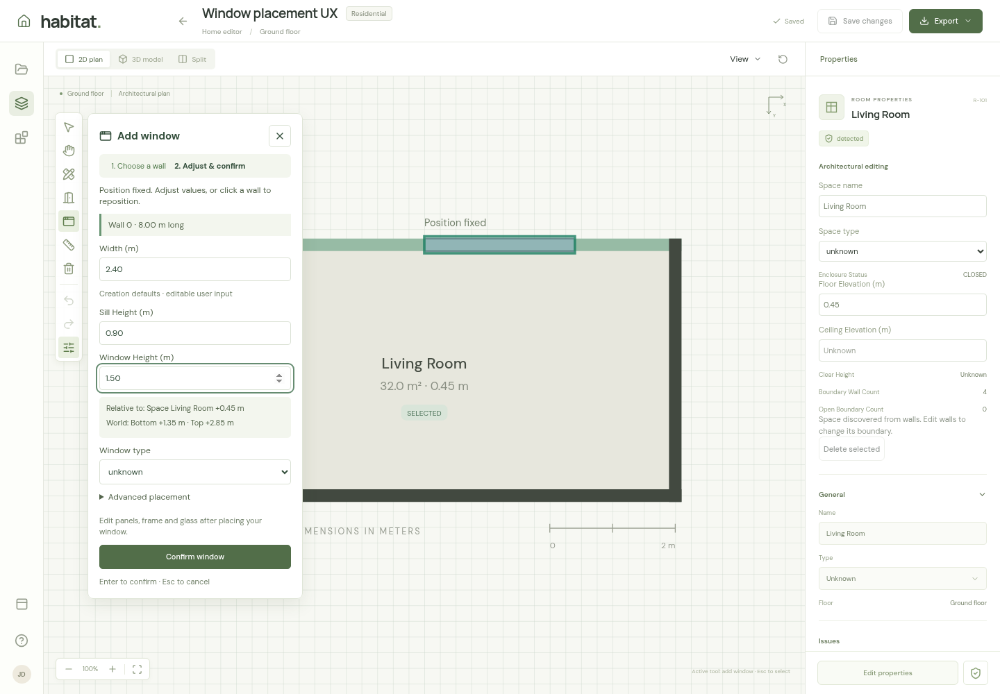
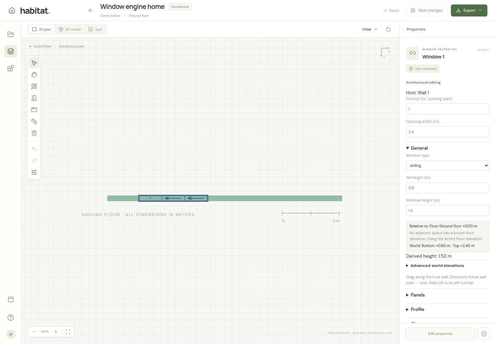
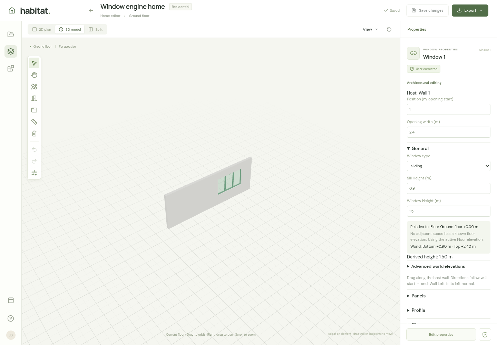

# Window UI and usage guide

Windows are openings attached to walls. Hover over a wall, click to fix the ghost position, adjust sill and height, and confirm. Then use the Properties sidebar to configure panels, frame, glass, shutter, and screen. **Confirm window adds it to the local drawing; Save changes persists it.**

This guide describes the current interface, with screenshots from the window browser workflow. All dimensions are in meters.

## What the interface looks like

The left canvas toolbar contains **Add window**, shown as a window icon. Clicking it opens a white settings card beside the toolbar and highlights the active tool in green. The card has two steps: **Choose a wall** and **Adjust & confirm**. It shows instructions, the chosen wall's name and length, dimension fields, a type dropdown, a green confirmation button, and an X to cancel.

The example above uses a 2.40 m wide window on an 8.00 m wall. The card floats over the plan; use the **Tool settings** icon to collapse or reopen it if it covers the area you need to click. On shorter screens, scroll inside the card to reach its remaining controls.

## Add a window

1. Open a floor with an existing wall, or use **Draw wall** first.
2. Click **Add window**, or press **N** while you are outside a text or number field. Starting this tool from the 3D view switches to the 2D plan.
3. Hover over a wall. The highlighted host and dashed ghost follow the pointer along the wall. Click to fix the candidate; moving the pointer afterward does not move it. Nothing is created yet.
4. Adjust **Width**, **Sill Height**, **Window Height**, and **Window type**. The reference and calculated world elevations update live. Click a wall again to reposition the candidate or choose another host. Numeric position is under **Advanced placement**, available after the first placement click.
5. Click **Confirm window**. The editor returns to Select, selects the new window, and displays its properties on the right.
6. Configure the assembly if needed, then click **Save changes** in the header.

Near a wall endpoint, the hovering ghost shifts inward only when the requested width fits. An amber outline and “Shifted inward to fit” label identify this adjustment. Width is never resized. A window wider than its wall remains invalid and has a red outline. After clicking to fix the candidate, changing width does not automatically move the position back into bounds.

**Esc** or the card's **X** cancels the unconfirmed placement. Esc also works while a placement field is focused. To add another window after confirmation, activate **Add window** again.

## Placement fields and elevations

| Field         | Meaning                                                     | Initial creation default |
| ------------- | ----------------------------------------------------------- | ------------------------ |
| Width         | Total opening width along the wall                          | 1.20 m                   |
| Sill Height   | Opening bottom above the indicated Space or Floor reference | 0.90 m                   |
| Window Height | Vertical opening size                                       | 1.20 m                   |
| Window type   | Fixed, casement, sliding, tilt turn, awning, or unknown     | Unknown                  |

These are editable creation defaults, not detected measurements. Width, sill, height, and type remain available for subsequent windows while the editor stays mounted.

The **Relative to** indicator identifies the reference used for conversion. A unique known adjacent-space elevation takes priority. If several adjacent spaces have the same known level, that common level is used. If their known levels differ, or none is known, the UI explicitly falls back to the active Floor elevation and explains why. Rejected spaces are excluded. The wall base is not added to this reference.

The conversion is **world bottom = reference + sill**, then **world top = bottom + window height**. World bottom and top remain the stored geometry; sill and height are editing inputs, not duplicate persisted values.

| Reference              | Sill   | Height | World bottom | World top |
| ---------------------- | ------ | ------ | ------------ | --------- |
| Space 0.00 m           | 0.90 m | 1.50 m | +0.90 m      | +2.40 m   |
| Space +0.45 m          | 0.90 m | 1.50 m | +1.35 m      | +2.85 m   |
| Floor +3.00 m fallback | 0.90 m | 1.20 m | +3.90 m      | +5.10 m   |

World values appear as secondary information and update live. **Advanced placement → Edit world elevations directly** enables direct entry during creation. In Properties, use **Advanced world elevations**.

If neither Space nor Floor provides a reliable reference, the UI explains that the elevation is unknown or ambiguous and asks for explicit world bottom and top. Both values must be supplied before creation can be confirmed. It never assumes a zero reference. Unknown values on existing windows remain unknown until edited.

Position measures from the wall's start to the opening's start. Position 1.00 m with width 2.40 m spans 1.00–3.40 m along the host.

## Feedback during placement

| State                           | What you see and do                                                                                  |
| ------------------------------- | ---------------------------------------------------------------------------------------------------- |
| No wall exists                  | The card asks you to draw a wall first.                                                              |
| Waiting for a wall              | Choose a wall is active; position and confirmation are disabled.                                     |
| Hovering a wall                 | A dashed ghost follows the pointer; confirmation remains disabled until a click fixes the candidate. |
| Candidate fixed                 | Adjust & confirm becomes active; the preview stays in place while you edit.                          |
| Invalid dimensions or placement | A red ghost and inline error explain the problem; confirmation is disabled.                          |
| Confirmed                       | The card closes and the selected window appears in Properties. Changes still need saving.            |

Typical errors include width at or below zero, extending beyond the wall, top elevation at or below bottom elevation, placement below the wall base or above its top, and physical overlap with another opening. Correct the relevant field or choose another position.

## Edit an existing window

Use **Select** or **V**, then click the window in the plan. The Properties sidebar shows its host, position, and opening width, followed by expandable sections. Numeric property edits apply when you leave the field or press Enter; dropdown choices apply immediately to the local drawing.

Sill and height edits show live world-coordinate feedback before committing on blur or Enter. Merely viewing the controls does not rewrite stored geometry. If a Space floor elevation changes later, the window stays at its canonical world position and the displayed relative sill changes. For example, world bottom +0.90 m remains +0.90 m when the Space floor changes from 0.00 to +0.10 m; the displayed sill becomes 0.80 m.

| Section | Controls and behavior                                                                                                                                                                        |
| ------- | -------------------------------------------------------------------------------------------------------------------------------------------------------------------------------------------- |
| General | Window type, Sill Height, Window Height, reference indicator, and secondary world elevations. Direct world editing remains available under Advanced world elevations.                        |
| Panels  | Set 1–100 panels, choose columns or rows, and click Apply panel layout. Configure each panel's operation and size ratios. Columns create vertical dividers; rows create horizontal dividers. |
| Profile | Choose frame material and frame/sash face widths and depths. A sash is the frame around an individual panel.                                                                                 |
| Glass   | Choose glazing type, finish, glass thickness, and overall glazing thickness. Individual panels can inherit the assembly finish or override it.                                               |
| Shutter | Choose a shutter type and, where applicable, manual/electric operation and box type.                                                                                                         |
| Screen  | Choose none, fixed, sliding, rolling, pleated, or unknown.                                                                                                                                   |

New windows start with **one panel of unknown operation**, unknown profile and glazing details, and no shutter or screen. Selecting the overall **sliding** type does not automatically make the panel slide. Open **Panels** and set each panel's operation and slide direction. Casement and tilt-turn panels expose hinge and swing controls.

Panel ratios describe portions of the opening, not meters. Their origin is the opening's bottom/start. Directions follow the host wall from start to end; “Wall Left” is the left side when facing that direction, regardless of the camera angle.

Drag an existing window in the 2D plan to move it along its current host. Dragging away from the wall does not detach it or change hosts. Moving or rotating the host carries its windows with it. If dragging or shortening the wall leaves an invalid opening, correct it before saving. Use **Delete selected** to remove a window; a wall with hosted openings cannot be deleted until those openings are removed.

## How windows appear in each view

In **2D plan**, windows appear as blue-gray strips inside walls. Selection darkens the strip. Panel divisions are visible: fixed panels have a small cross, sliding panels show direction arrows when known, and configured casement panels show a hinge and dashed swing guide. An unknown sliding direction uses a dashed line. These symbols describe panel operation.

In **3D model**, known geometry creates a real opening in the wall with frame, panel divisions, and translucent glass. Selection highlights the assembly in green. Glass finish changes its appearance. Unknown profile dimensions use illustrative sizes; they do not become measured dimensions. Shutters and screens are recorded as requirements and are not modeled as detailed 3D components. Panel operation is not an animated opening simulation.

**Split** displays the plan and model together. Both views share the same window and selection. Complete the width, position, and elevations to obtain a meaningful 3D preview; unknown geometry can prevent an assembly from rendering and cause its host wall solid to be omitted.

## Shortcuts and saving

| Action                                                  | Shortcut                   |
| ------------------------------------------------------- | -------------------------- |
| Start Add window                                        | N                          |
| Return to Select                                        | V                          |
| Confirm a valid fixed candidate outside input controls  | Enter                      |
| Cancel window placement, including from a focused field | Esc                        |
| Undo                                                    | Ctrl/Cmd+Z                 |
| Redo                                                    | Ctrl/Cmd+Shift+Z or Ctrl+Y |
| Save changes                                            | Ctrl/Cmd+S                 |

Except for Esc during window placement, editor shortcuts leave focused input controls to their normal keyboard behavior. Use the visible confirmation and save buttons while editing fields.

Save validates the whole drawing and reports errors that need correction. Successful saving clears local undo history. Navigating away with unsaved edits prompts you to stay or discard them.

Older windows can display **legacy centre** positioning or unknown assembly details. Follow their field labels; use **Configure assembly · one unknown panel** to add assembly controls. Editing their elevations switches them to world elevations.

For the broader workspace, see [Architectural drawing workspace](ARCHITECTURAL_EDITOR.md). The [window browser workflow](../tests/e2e/windows-workflow.spec.ts) exercises placement, validation, keyboard cancellation, assembly editing, saving/reloading, 3D rendering, and host movement.

The [hover and sill browser workflow](../tests/e2e/window-placement.spec.ts) covers ghost movement, endpoint fitting, angled hosts, elevated and unknown references, and preserved window world geometry after a Space level change.
